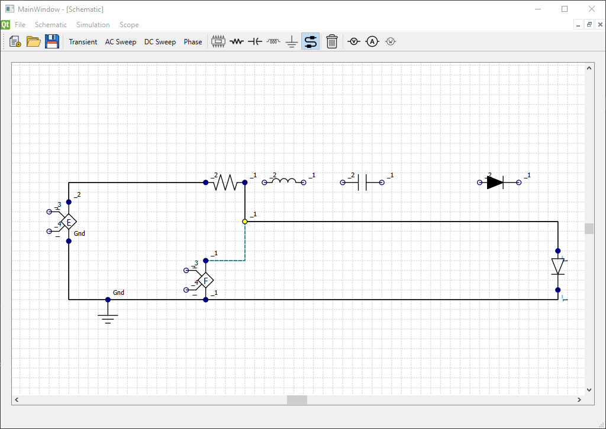
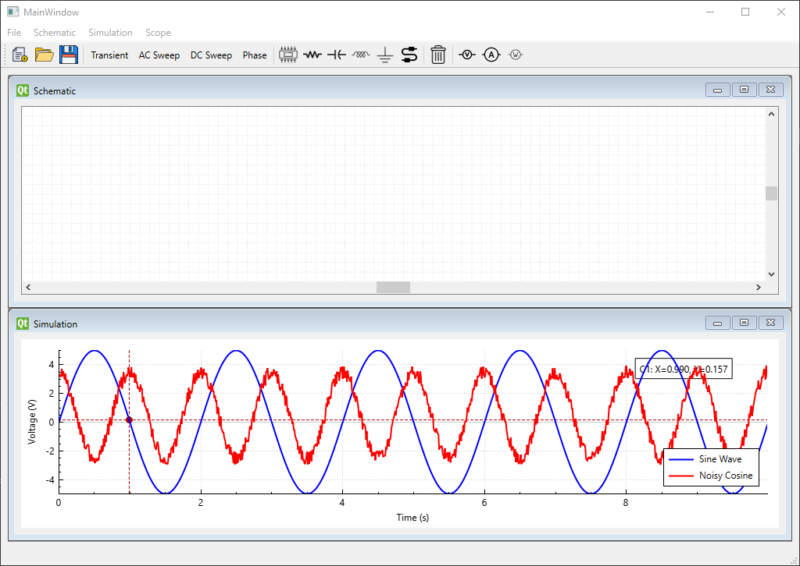

# 🦄 Unicorn SPICE

*A circuit simulator, made for learning. Mostly learning things the hard way.*

SPICE is a fundamental tool in electronics, but building one from scratch is an entirely different experience.

**Unicorn SPICE** is an ongoing attempt to implement a circuit simulator in C++ using Qt. It started as a way to better understand circuit analysis, numerical methods, Object oriented programming, and the software behind schematic-based simulation tools.

The result is a project with a graphical circuit editor, several analysis modes, and a waveform viewer — held together by varying amounts of ambition and questionable engineering decisions.

And no, we cannot guarantee that your hair will survive the experience.

> [!WARNING]
> **Work in progress.** This project is experimental, incomplete, and rough around the edges. Many features may be unreliable, partially implemented, or simply not work as expected. Expect bugs, awkward workflows, and the occasional disappointing result. Use it to explore the code and experiment, not as a dependable engineering tool.

---

## 🔧 What's in the box?

The project currently contains implementations or experiments involving the following features. Their presence in the codebase does not necessarily mean they work correctly.

### Circuit editing

- A graphical environment for placing and connecting circuit components.
- Automatic wire routing.
- Voltage, current, and power probing.

### Circuit analysis

The codebase includes several types of analysis:

- Transient analysis
- AC sweep
- DC sweep
- Phase analysis

The completeness and reliability of these analyses may vary. Numerical accuracy and agreement with established SPICE implementations have not been established for every case.

### Waveform viewer

An attempt at making simulation results easier to inspect, with features including:

- Multiple traces.
- Multiple cursors.
- Panning and zooming.
- Randomized colors for distinguishing traces.

### Component models

The project contains code for working with a range of circuit elements:

- Resistors, capacitors, and inductors.
- Ideal and silicon diodes.
- AC and DC voltage and current sources.
- Controlled sources.


### Code organization

The project uses an MVC-inspired structure to separate application logic, circuit data, and the graphical interface. The structure is intended to make experimentation and further development easier, although the implementation is still evolving.

---

## 🧰 Built with

- **C++17** — the main programming language.
- **Qt** — the graphical interface.
- **CMake** — the build system.
- **Eigen3** — linear algebra.

The project is designed with cross-platform development in mind, but successful builds and equivalent behavior across platforms are not guaranteed.

---

## 🚧 Project status

This is a work in progress, not a finished application.

The project is useful primarily as a learning exercise and as a place to experiment with the implementation of a circuit simulator. Features may be unfinished, unreliable, or subject to substantial changes.

There is no guarantee that every listed analysis, component model, or editor feature currently works correctly. Treat simulation results as experimental, and verify important results using established tools and independent calculations.

There may be long periods without development, and some rough edges may remain unfixed indefinitely.

---

## 🛠️ Building from source

The project uses CMake and requires a compatible C++ compiler, Qt, and Eigen3. We recommend using [MSYS2](https://www.msys2.org/) to manage dependencies and libraries.

```bash
git clone https://github.com/ArmanHaghighi/unicorn_SPICE.git
cd unicorn_SPICE
cmake -S . -B build -G Ninja -DCMAKE_BUILD_TYPE=Release
cmake --build build
```

These are the standard CMake and Ninja build commands; dependencies must be installed and discoverable by CMake beforehand. Build success may depend on your environment and the current state of the code.

---

## 🐛 Bugs, limitations, and contributions

Expect bugs. If you find one, feel free to open an issue describing what happened, what you expected, and how to reproduce it.

Suggestions and contributions are welcome, but please keep in mind that this is an experimental project rather than a maintained, production-ready simulator.

---

## 🦄 Why publish it, then?

Because unfinished projects can still be worth sharing.

If you're curious about how a circuit simulator might be structured, interested in the implementation, or simply want to see what can go wrong when building one from scratch, you're welcome to take a look.

Just don't trust it with your next electronics homework.

---
## 📸 Screenshots

### Circuit editor


### Waveform viewer


---
*Made with C++, Qt, and a healthy disregard for how much work this would turn out to be.*
